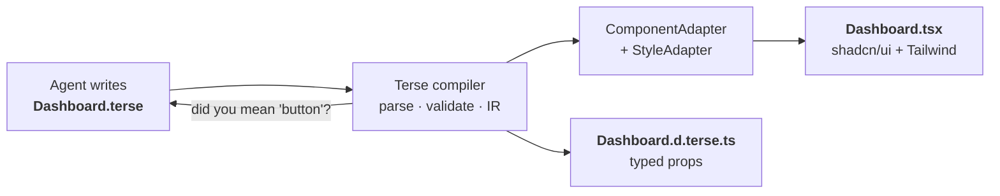
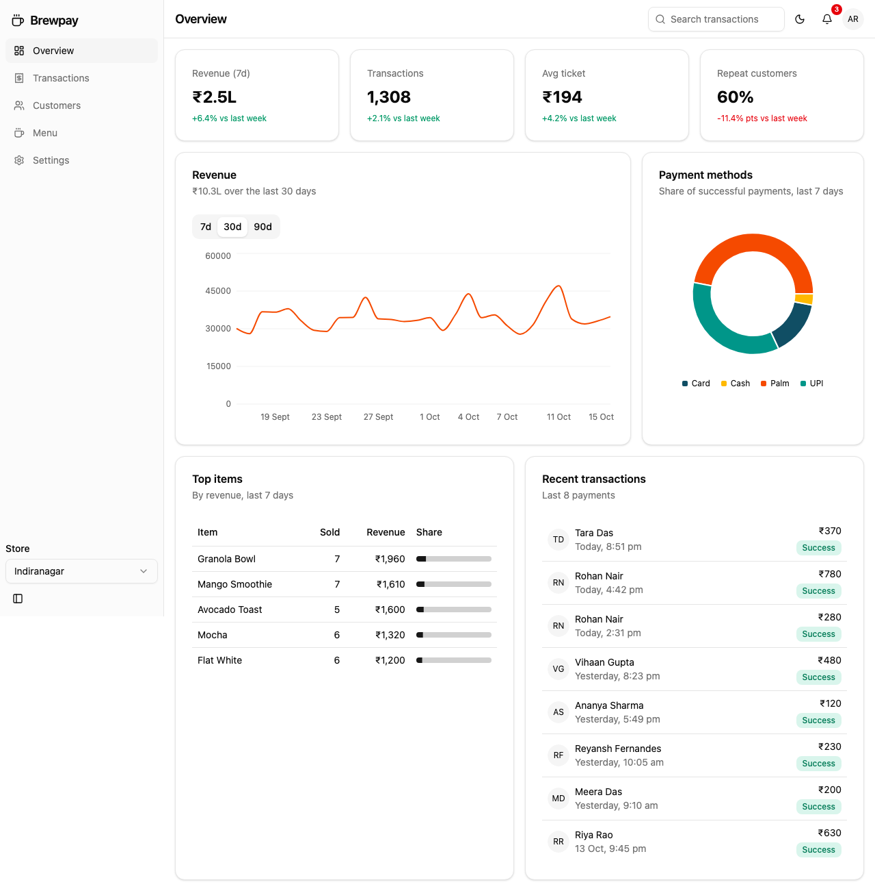

<div align="center">

# Terse

**Build React UIs with 75% fewer agent tokens.**

Terse is the UI language your coding agent writes in. It compiles at build time to the same
React + shadcn/ui + Tailwind your agent would otherwise write, with **zero runtime**.

[](https://www.npmjs.com/package/@terseui/vite-plugin)
[](https://www.npmjs.com/package/create-terse-app)
[](LICENSE)
[](https://react.dev)
[](https://vite.dev)



</div>

Most React UI is now written by agents, in a format designed for people. A typical component spends
more than half its tokens on class names, imports, prop types and closing tags. Terse is a small,
strict language for the part agents write most (what a screen *shows*), and a compiler that turns it
into ordinary TSX you could have written yourself.

```
props stats, orders, onRefresh

page "Dashboard"
  grid cols=1,3
    stat "Revenue" @stats.revenue delta=@stats.delta icon=dollar-sign
    stat "Orders" @stats.orders icon=shopping-cart
  card "Recent orders"
    table @orders cols=id,customer,total
  button "Refresh" variant=outline on=@onRefresh
```

## Quick start

```sh
npm create terse-app@latest my-app
cd my-app && npm install && npm run dev
```

<sub>Also works with `pnpm create terse-app`, `yarn create terse-app` and `bun create terse-app`.</sub>

You get a Vite + React + TypeScript app with Tailwind v4, the shadcn/ui components Terse renders to,
an example view and its container, and `AGENTS.md` / `CLAUDE.md` files that teach your agent the
language. Then ask your agent for a screen.

> [!TIP]
> Adding Terse to an existing Vite + shadcn/ui app instead? See [docs/getting-started.md](docs/getting-started.md).

## How it works



Views are `.terse`; state, effects and fetching stay in TSX. A container passes data and handlers in
as props, and each file imports the other like any module:

<table>
<tr><th><code>pages/DashboardPage.tsx</code>: logic</th><th><code>views/Dashboard.terse</code>: presentation</th></tr>
<tr><td>

```tsx
import Dashboard from '@/views/Dashboard.terse'

export default function DashboardPage() {
  const { stats, orders, refresh } = useDashboard()
  return (
    <Dashboard
      stats={stats}
      orders={orders}
      onRefresh={refresh}
    />
  )
}
```

</td><td>

```
props stats, orders, onRefresh

page "Dashboard"
  grid cols=1,3
    stat "Revenue" @stats.revenue
    stat "Orders" @stats.orders
  card "Recent orders"
    table @orders cols=id,customer,total
  button "Refresh" on=@onRefresh
```

</td></tr>
</table>

<details>
<summary><b>See the TSX it compiles to</b></summary>

```tsx
import { Card, CardContent, CardHeader, CardTitle } from "@/components/ui/card"
import { Table, TableBody, TableCell, TableHead, TableHeader, TableRow } from "@/components/ui/table"
import { Button } from "@/components/ui/button"

export default function Dashboard({ stats, orders, onRefresh }: DashboardProps) {
  return (
    <main className="mx-auto flex w-full flex-col gap-6 p-6 max-w-6xl">
      <h1 className="text-3xl font-bold tracking-tight">Dashboard</h1>
      <div className="grid gap-4 grid-cols-1 md:grid-cols-3">
        <Card className="flex-1">
          <CardContent className="flex flex-col gap-2">
            <p className="text-sm text-muted-foreground">Revenue</p>
            <p className="text-2xl font-bold">{stats?.revenue}</p>
          </CardContent>
        </Card>
        {/* … the Orders stat, same shape … */}
      </div>
      <Card>
        <CardHeader>
          <CardTitle>Recent orders</CardTitle>
        </CardHeader>
        <CardContent className="flex flex-col gap-4">
          <Table>
            <TableHeader>
              <TableRow>
                <TableHead>Id</TableHead>
                <TableHead>Customer</TableHead>
                <TableHead>Total</TableHead>
              </TableRow>
            </TableHeader>
            <TableBody>
              {orders?.map((row: any, i: number) => (
                <TableRow key={i}>
                  <TableCell>{row?.id}</TableCell>
                  <TableCell>{row?.customer}</TableCell>
                  <TableCell>{row?.total}</TableCell>
                </TableRow>
              ))}
            </TableBody>
          </Table>
        </CardContent>
      </Card>
      <Button className="w-fit" onClick={onRefresh}>Refresh</Button>
    </main>
  )
}
```

Plain, readable TSX with nothing to eject from. Commit it and stop using Terse whenever you like.

</details>

## Why Terse

| | |
|---|---|
| **~75% fewer tokens** | Five common screens: 755 tokens of Terse against 3,130 of TSX. Less to generate, less context used, faster edits. |
| **Errors an agent can fix** | A small vocabulary means precise diagnostics: `Dashboard.terse:24:5 unknown component 'buton' — did you mean 'button'?` The agent fixes it in one edit. |
| **A design system enforced by grammar** | Spacing, tone and size are tokens (`gap=md`, `tone=muted`). There's no way to write `gap-[13px]`, so agents can't drift. |
| **Typed props for free** | The plugin writes `X.d.terse.ts` with props inferred from usage, so a container passing `isfirst` instead of `isFirst` fails `tsc`. |
| **Zero runtime, no lock-in** | It compiles away at build time to the shadcn/ui code you'd ship anyway. |
| **Adopt one screen at a time** | `.tsx` imports `.terse` and `.terse` uses `.tsx` (`use UserAvatar from "…"`). Nothing else changes. |
| **Portable** | The compiler only talks to a `ComponentAdapter` and a `StyleAdapter`. shadcn/ui + Tailwind today; other design systems are an adapter away. |
| **Real dev loop** | A Vite plugin with hot reload, source maps back to `.terse` lines, errors in the Vite overlay, and a VS Code extension. |

## Benchmarks

Each screen is written twice: in Terse, and as the idiomatic shadcn + Tailwind TSX an agent writes
today (typed props included). Tokens are counted with `o200k_base`.

| Screen | Terse | TSX | Saved |
|---|---:|---:|---:|
| Dashboard | 188 | 927 | **79.7%** |
| Data table | 161 | 630 | **74.4%** |
| Login form | 122 | 441 | **72.3%** |
| Pricing page | 102 | 379 | **73.1%** |
| Settings page | 182 | 753 | **75.8%** |
| **Total** | **755** | **3,130** | **75.9%** |

The TSX that Terse compiles to is about the same size as the TSX it replaces (3,193 tokens), so the
savings don't come from worse output. Reproduce with `pnpm bench`; the files are in
[`benchmarks/prompts`](benchmarks/prompts).

> [!NOTE]
> These are static token counts with OpenAI's tokenizer, which only approximates Claude's. An agent
> eval (the same screens built end to end, measuring tokens, time and fix iterations) is on the roadmap.

## Built with Terse



**Brewpay** is a five-page cafe payments dashboard (overview, transactions, customers, menu and
settings) used to stress-test the language. Every view is Terse: 12 views, 431 lines, 4,743 tokens,
which compile to 17,938 tokens of TSX. It works at phone, tablet and desktop widths in light and dark
mode. Source in [`examples/playground`](examples/playground), write-up in
[`benchmarks/results/stress`](benchmarks/results/stress).

## Teach your agent

The spec is written for models to learn from. `create-terse-app` sets this up for you; for an
existing project, add it to `CLAUDE.md`:

```md
@node_modules/@terseui/core/SPEC.md
@node_modules/@terseui/core/components.md
```

For agents without file imports (`AGENTS.md`, Cursor rules and so on), tell them to read those two
files before writing a `.terse` view. The spec ships inside `@terseui/core`, so it always matches the
compiler version you have installed.

## The language at a glance

```
use { SidebarMenu } from "@/components/ui/sidebar"   # import TSX components (default or named)
props tasks, filter, setFilter, move, addTask         # what the view receives

page "Board"
  togglegroup value=@filter on=@setFilter             # style is tokens; data is @references
    toggle "All" value=all
    toggle "Mine" value=mine
  each @tasks as task key=id                          # loops, with stable keys
    card @task.title href=@task.url
      if @task.blocked                                # conditions (if / if not / else)
        badge "Blocked" tone=destructive
      button "Done" pressed=@task.done on=@move(@task.id, 1)   # handlers can take arguments
  form on=@addTask                                    # Enter submits
    input "New task" name=title
```

**51 components** (current `main`) in six groups:

| Group | Components |
|---|---|
| Layout | `page` `band` `section` `row` `col` `grid` `spacer` `card` `separator` |
| Content | `heading` `text` `badge` `avatar` `progress` `skeleton` `stat` `icon` `callout` `image` `link` `code` |
| Data | `table` `thead` `th` `tr` `td` `list` `item` `chart` `series` |
| Input | `button` `input` `textarea` `select` `switch` `checkbox` `tabs` `tab` `togglegroup` `toggle` `form` |
| App chrome | `shell` `sidebar` `navitem` `bar` |
| Overlays | `menu` `menuitem` `dialog` `sheet` `trigger` · plus `slot` for passing in React nodes |

Text supports inline `**strong**`, `*em*`, `` `code` `` and `[links](https://…)`. The full reference:
**[spec/SPEC.md](spec/SPEC.md)** and **[spec/components.md](spec/components.md)**.

## Editor support

A VS Code extension in [`editors/vscode`](editors/vscode) adds syntax highlighting, 2-space editing
defaults and live diagnostics (the same errors the compiler reports, as you type). It isn't on the
Marketplace yet; build and install it with:

```sh
node editors/vscode/pack.mjs && code --install-extension editors/vscode/terse.vsix
```

## FAQ

<details>
<summary><b>Models already know TSX well. Why a new language?</b></summary>

They do, which is why they write so much of it. The cost isn't knowing the format, it's producing
it: every class name and closing tag is output you pay for, wait on and review. Terse's spec is small
enough to fit in context, and its compiler errors are precise enough that an agent corrects itself in
one edit.
</details>

<details>
<summary><b>Isn't this lock-in?</b></summary>

No. The output is plain TSX using your own shadcn/ui components. Commit the compiled files and remove
the plugin, and you're left with a normal React app.
</details>

<details>
<summary><b>What about logic: state, effects, data fetching?</b></summary>

That stays in TSX on purpose. Terse views have no expressions, hooks or state; they receive
everything as props. Containers handle the logic, so agents keep logic and presentation separate.
</details>

<details>
<summary><b>Why not JSON or YAML for UI?</b></summary>

Those are data formats. Terse is a typed grammar with a compiler that knows every component and prop,
so mistakes fail the build with a location and a fix, instead of rendering wrong at runtime.
</details>

<details>
<summary><b>How is this different from generative UI at runtime?</b></summary>

Runtime generative UI renders components a model streams to users. Terse is for UI your agent writes
into your codebase: it's compiled away at build time, reviewed in PRs and shipped as ordinary code.
</details>

<details>
<summary><b>Do I have to use shadcn/ui?</b></summary>

Today, yes: `@terseui/adapter-shadcn` is the only component adapter. The compiler talks to UI
libraries only through two small interfaces, so a Material UI or Chakra adapter is a self-contained
package. Contributions are welcome.
</details>

## Roadmap

- [x] Language, compiler and Vite plugin (hot reload, source maps, error overlay)
- [x] shadcn/ui + Tailwind adapters, 51 components
- [x] `create-terse-app`
- [x] Typed props via generated `.d.terse.ts`
- [ ] Drag and drop (`draggable`, drop targets)
- [ ] Agent eval: real Claude Code runs, Terse vs TSX
- [ ] Claude Code plugin with a `terse check` hook, so agents see errors as they save
- [ ] More adapters (Material UI, Chakra UI, React Native)
- [ ] In-browser playground

## Packages

| Package | |
|---|---|
| [`@terseui/core`](packages/core) | Lexer, parser, IR, validator and component schema. No React. Ships the spec. |
| [`@terseui/compiler`](packages/compiler) | IR → TSX, source maps, inferred prop types, adapter interfaces |
| [`@terseui/adapter-shadcn`](packages/adapter-shadcn) | Renders components as shadcn/ui |
| [`@terseui/style-tailwind`](packages/style-tailwind) | Maps style tokens to Tailwind classes |
| [`@terseui/vite-plugin`](packages/vite-plugin) | Compiles `*.terse` in Vite: hot reload, source maps, overlay, `.d.terse.ts` |
| [`create-terse-app`](packages/create-terse-app) | `npm create terse-app`: a ready-to-go app |

## Contributing

```sh
pnpm install
pnpm test     # parser, validator, compiler snapshots, type inference, spec drift
pnpm dev      # the playground (builds the packages first)
pnpm bench    # the token comparison
```

[`AGENTS.md`](AGENTS.md) covers the architecture rules and the checklist for adding a component. The
biggest open areas are new adapters, drag and drop, and the agent eval. Issues and PRs welcome.

## License

[MIT](LICENSE) © 2026 AVYUKT TECH LABS
